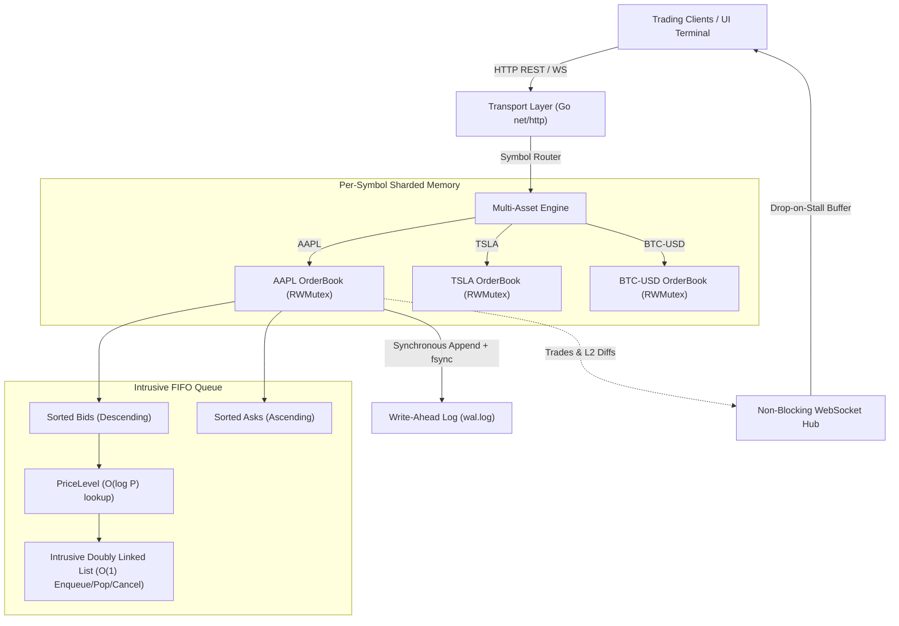

# OME: Cache-Conscious Order Matching Engine & L2 Market Feed

[](https://github.com/divya-3005/matching-engine-journey/actions/workflows/ci.yml)
[](https://golang.org)
[](https://opensource.org/licenses/MIT)

A high-throughput, Price-Time Priority (FIFO) financial order matching engine and real-time L2 market data feed written from scratch in Go. 

Most open-source matching engines are either simplistic educational exercises reliant on heap-heavy containers and global mutexes, or distributed systems where the matching kernel is obscured behind gRPC and message broker layers. This project was built to explore **mechanical sympathy in Go**: optimizing data structures for L1/L2 cache locality, eliminating heap allocations on the critical matching path, isolating lock contention per asset, and implementing deterministic Write-Ahead Logging (WAL) with fail-closed crash recovery.

---

## Performance Profile

### 1. In-Memory Throughput & Latency (Apple M3, ARM64, Go 1.22)

```bash
pkg: github.com/divya-3005/OME/server/engine
cpu: Apple M3
BenchmarkProcessOrder-8          	 2915558	       413.5 ns/op	     335 B/op	       4 allocs/op
BenchmarkProcessOrderWithWAL-8   	     214	   5780523 ns/op	     553 B/op	       8 allocs/op
```

- **In-Memory Matching Throughput**: **~2.92M matching cycles/sec** ($\approx \mathbf{5.84M\text{ orders/sec}}$), where each benchmark cycle processes an aggressive crossing limit order and a replenishing counter-order.
- **Mean Single-Order Latency**: **~206.8 ns**.
- **Heap Allocations**: **4 allocs / cycle** ($1$ `Order` struct per order, $1$ `Trade` struct + slice backing array per execution). The intrusive doubly linked list introduces **0 auxiliary node allocations**.
- **WAL Persistence Throughput**: $\approx 5.78\text{ ms/op}$ with synchronous atomic disk `fsync` per transaction on physical NVMe storage.

### 2. Tail Latency Distribution ($N = 100,000$ live samples)

Averages in financial infrastructure hide tail risk (stop-the-world GC pauses and lock stalls). The engine was profiled across 100,000 continuous matching cycles with steady-state book depth:

| Percentile | Measured Latency | Operational Context |
| :--- | :--- | :--- |
| **p50 (Median)** | **125 ns** | Hot L1/L2 cache hit on best ask and head queue pointer |
| **p90** | **250 ns** | Level transition and trade slice instantiation |
| **p99** | **542 ns** | Order map index mutation under concurrent execution |
| **p99.9** | **9.7 µs** | Operating system scheduler preemption and cache line invalidation |
| **Max** | **340 µs** | Worst-case OS page eviction |

---

## Architectural Principles & Mechanical Sympathy



### 1. Intrusive Doubly Linked Lists ($O(1)$ Enqueue & Unlink)
Standard list implementations (such as Go's `container/list`) wrap payload pointers inside a container struct (`list.Element`). Under high order volume, this induces severe heap churn and garbage collector pressure.
- By embedding `Prev *Order` and `Next *Order` pointers directly inside the `Order` struct, enqueuing an order onto a `PriceLevel` requires **zero extra heap allocations**.
- Dequeueing the matched head order runs in $O(1)$ time.
- Mid-queue cancellations take an order ID, resolve its pointer in $O(1)$ via the hash table index (`Orders map[uint64]*Order`), and unlink it in $O(1)$ time without scanning the queue.

### 2. Cache-Friendly Sorted Price Levels
- Rather than navigating pointer-chasing balanced trees (e.g. Red-Black or AVL trees) which incur frequent cache misses across dispersed memory nodes, price levels are stored in sorted slices (`[]*PriceLevel`).
- Finding a price level uses binary search (`sort.Search`) in $O(\log P)$ time.
- Because active liquidity in financial order books clusters tightly around the inside spread, keeping contiguous pointers in slice memory maximizes L1/L2 spatial locality. When a level is depleted, nil-clearing prevents pointer retention in the backing array.

### 3. Fixed-Point Precision & Overflow Protection
- IEEE-754 floating-point numbers (`float64`) introduce precision errors (`0.1 + 0.2 = 0.30000000000000004`) that compromise accounting and audit ledgers.
- All prices and quantities are represented as fixed-point integers (`uint64` cents/ticks).
- Strict domain boundaries (`MaxOrderAmount = 1,000,000,000` and `MaxOrderPrice = 1,000,000,000,000`) guarantee that queue volume accumulations within `PriceLevel.TotalVolume` can never overflow a 64-bit integer while remaining below $2^{53}-1$ for lossless JavaScript JSON interop.

### 4. Fine-Grained Concurrency Isolation
- Multi-asset exchanges using a global lock suffer severe cross-symbol lock contention.
- In OME, synchronization is strictly isolated per `OrderBook` via `sync.RWMutex`. An aggressive trading bot submitting order flow for `AAPL` acquires only the `AAPL` book lock; matching routines and book queries for `TSLA` and `BTC-USD` proceed concurrently across separate CPU cores.
- Fully validated race-free across all concurrent routines using Go's `-race` detector.

### 5. ACID Persistence & Self-Healing WAL Recovery
To guarantee zero transaction loss across unplanned crashes:
- **Strict Write-Ahead Discipline**: Incoming orders and cancellations are serialized and committed to disk via `fsync()` before any in-memory state is altered.
- **Fail-Closed Semantics**: If an `os.File.Write` or `fsync` fails, the WAL rolls back file length to the previous known-good byte offset, marks itself `broken`, and halts further mutation to prevent corrupted split-brain states.
- **Deterministic Crash Recovery**: On reboot, `Recover()` sequentially replays valid records into fresh order books, restoring resting liquidity and advancing the sequence generator past the highest recovered ID.
- **Torn-Write Pruning vs. Tamper Detection**: Incomplete trailing records caused by mid-write power loss are automatically pruned. If corruption occurs mid-file with valid records after it, the engine refuses to start, preventing silent data destruction of acknowledged trades.

### 6. Non-Blocking Ticker Plant (Backpressure Defense)
A slow WebSocket consumer (e.g., a laggy browser client) must never degrade matching engine performance:
- Each client maintains an isolated `writePump` with a 256-event buffered channel (`chan []byte`).
- Broadcasts use non-blocking channel selects. If a client buffer saturates, the hub drops the slow connection rather than applying backpressure to the matching engine.
- WebSocket payloads deliver exactly one atomic JSON event per frame (`TextMessage`).

---

## Invariant Fuzzing & Verification

The engine is continuously verified using native Go property-based fuzz tests (`make fuzz`), subjecting the order book to randomized order flows across all permutations of sides, order types, prices, and amounts.

Every fuzz iteration asserts four strict financial and structural invariants:
1. **Crossed-Book Prevention**: `BestBid.Price < BestAsk.Price` strictly holds for all resting liquidity.
2. **Volume Conservation**: `PriceLevel.TotalVolume` strictly equals the aggregate sum of all resting orders in its queue.
3. **Intrusive DLL Symmetry**: For every node in the queue, `order.Next.Prev == order` and `order.Prev.Next == order`.
4. **Index Consistency**: Every order registered in `ob.Orders` contains a positive quantity matching its queue state.

---

## Project Structure

```
OME/
├── Makefile                # Unified build, test, benchmark, fuzz, and profiling targets
├── LICENSE                 # MIT License
├── README.md               # Technical whitepaper & operational guide
├── render.yaml             # Cloud deployment specification
└── server/
    ├── go.mod / go.sum     # Go 1.22 module definition
    ├── main.go             # HTTP/WS server, routing, graceful shutdown orchestration
    ├── main_test.go        # HTTP endpoints & integration test suite
    ├── hub.go              # WebSocket broadcast hub with backpressure mitigation
    ├── hub_test.go         # Concurrency, slow-client drop, and lifecycle tests
    ├── simulator.go        # Institutional order flow simulator (spread tightening)
    ├── simulator_test.go   # Liquidity recovery, race-safety, and order flow tests
    ├── public/             # Institutional trading terminal (HTML5 Canvas L2 Depth & Candlesticks)
    └── engine/
        ├── order.go        # Order struct, fixed-point types, intrusive pointers
        ├── price_level.go  # Intrusive Doubly Linked List FIFO queue
        ├── order_book.go   # Price-Time Priority matching algorithm & index
        ├── order_book_test.go # Full matches, partial fills, latency percentiles, fuzzing
        ├── trade.go        # Immutable execution record
        ├── engine.go       # Multi-asset registry and symbol routing
        ├── errors.go       # Domain sentinel errors and boundary limits
        ├── wal.go          # Append-only Write-Ahead Log with atomic fsync
        └── wal_test.go     # Crash recovery, corruption detection, and rollback tests
```

---

## Getting Started

### Prerequisites
- **Go 1.22 or higher**

### 1. Build & Run
```bash
# Build the binary
make build

# Start the server and trading terminal
make run
```
Open **[http://localhost:8080](http://localhost:8080)** to access the live trading dashboard.

### 2. Run Comprehensive Test Suite with Race Detector
```bash
make test
```

### 3. Run Property-Based Invariant Fuzzing
```bash
make fuzz
```

### 4. Measure Real-Time Latency Percentiles (p50, p90, p99, p99.9)
```bash
make latency
```

### 5. Profile CPU & Memory Allocation Hotspots
```bash
# Generate CPU pprof profile
make profile-cpu
go tool pprof -top server/cpu.pprof

# Generate Memory allocation profile
make profile-mem
go tool pprof -top server/mem.pprof
```

---

## API Reference

### 1. Submit an Order
`POST /order`
```bash
# Limit Buy: 10 AAPL @ $150.00 (price in cents: 15000)
curl -X POST http://localhost:8080/order \
  -H "Content-Type: application/json" \
  -d '{
    "symbol": "AAPL",
    "side": 0,
    "type": 0,
    "price": 15000,
    "amount": 10
  }'

# Market Buy: 5 AAPL (immediate execution against resting asks)
curl -X POST http://localhost:8080/order \
  -H "Content-Type: application/json" \
  -d '{
    "symbol": "AAPL",
    "side": 0,
    "type": 1,
    "amount": 5
  }'
```
*Note: `side: 0` = Buy, `side: 1` = Sell. `type: 0` = Limit, `type: 1` = Market. Order IDs and timestamps are assigned server-side.*

### 2. Cancel a Resting Order
`DELETE /order?symbol=AAPL&id=1`
```bash
curl -X DELETE "http://localhost:8080/order?symbol=AAPL&id=1"
```

### 3. Query L2 Order Book Depth
`GET /orderbook?symbol=AAPL`
```bash
curl "http://localhost:8080/orderbook?symbol=AAPL"
```

### 4. Query Execution History
`GET /trades?symbol=AAPL&limit=50`
```bash
curl "http://localhost:8080/trades?symbol=AAPL&limit=50"
```

### 5. Query Open Resting Orders
`GET /orders?symbol=AAPL`
```bash
curl "http://localhost:8080/orders?symbol=AAPL"
```

---

## Design Trade-offs & Engineering Retrospective

#### Why sorted slices over balanced binary search trees (Red-Black / AVL) for price levels?
While an AVL tree offers $O(\log N)$ insertions versus $O(N)$ worst-case slice shifts, modern CPU architectures strongly reward memory locality. Balanced trees scatter nodes across the heap, requiring pointer traversals that trigger L1/L2 cache misses on every access. In liquid financial books, orders cluster tightly around the best bid and ask (typically within 50–200 price levels). Within this range, contiguous slice elements fit neatly into CPU cache lines, where binary search and localized memory copies vastly outpace pointer-chasing tree traversals.

#### Why fine-grained `sync.RWMutex` over Go channels / actor model for the core engine?
A common pattern in Go is assigning each order book an independent goroutine communicating via channels. While idiomatic, Go channel operations incur runtime scheduler handoffs and internal channel mutex locks costing ~40–60 ns per message. By isolating books via `sync.RWMutex`, an uncontended read/write lock takes ~10–15 ns. For a single-node matching kernel processing millions of operations per second, fine-grained mutexes deliver lower mean latency and significantly smaller tail variance.

#### Why synchronous single-order `fsync` versus batched group commits in WAL?
In strict ACID transaction processing, acknowledging an order before it hits physical disk risks data loss. Calling `fsync` synchronously per transaction bounds throughput to ~180 ops/sec due to hardware SSD flush latencies (~5.7 ms). In production enterprise environments (such as high-volume payment processing), throughput is scaled by switching to **Group Committing**: holding incoming orders in a thread-safe staging buffer and executing a single `fsync` every 500 microseconds or upon reaching a byte threshold, bridging durability with 100,000+ ops/sec throughput.

---

## License
MIT License. Authored and maintained by Divya Singh.
